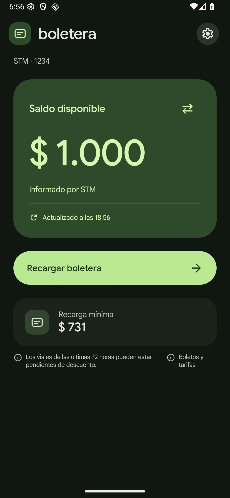
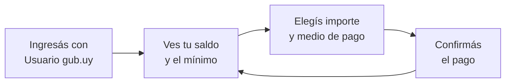

<picture>
  <source media="(prefers-color-scheme: dark)" srcset="docs/media/boletera-hero-dark.svg">
  <source media="(prefers-color-scheme: light)" srcset="docs/media/boletera-hero-light.svg">
  
</picture>

<p align="center">
  <a href="https://github.com/jmestrallet/boletera-android/releases/tag/v0.2.32"></a>
  &nbsp;
  <a href="https://github.com/jmestrallet/boletera-android/releases/tag/v0.2.32-beta.1"></a>
</p>

<p align="center">
  
  
  
  
</p>

<p align="center">
  <a href="#qué-funciona-hoy">Qué funciona</a> ·
  <a href="#cómo-funciona">Cómo funciona</a> ·
  <a href="#instalar">Instalar</a> ·
  <a href="#privacidad-y-seguridad">Privacidad</a> ·
  <a href="CHANGELOG.md">Cambios</a> ·
  <a href="#compilar">Compilar</a>
</p>

> [!NOTE]
> Boletera es un proyecto independiente y de código abierto. No es una aplicación oficial de STM, la Intendencia de Montevideo ni gub.uy.

<table>
  <tr>
    <td width="42%" align="center" valign="middle">
      
    </td>
    <td width="58%" valign="middle">
      <h3>Todo lo importante, en un solo lugar</h3>
      <p><strong>Saldo a la vista.</strong><br>El saldo disponible y el mínimo de recarga, tal como los informa STM.</p>
      <p><strong>Recargar sin vueltas.</strong><br>Elegís boletera, importe y medio de pago; la app se encarga de los pasos mecánicos.</p>
      <p><strong>Nativa de verdad.</strong><br>Acceso, recarga y Prex con interfaz Android propia. Tema claro, oscuro o automático.</p>
      <p><strong>Siempre al día.</strong><br>Actualizaciones firmadas desde la propia app, en canal Estable o Beta.</p>
    </td>
  </tr>
</table>

## Un proyecto personal para hacer la STM más simple

La idea nació para resolver algo que hago seguido: consultar el saldo y cargar la STM. La web oficial cumple su función, pero para el uso diario quería un camino más directo y cómodo desde el celular.

Como yo ingreso con **Usuario gub.uy** y recargo con **Prex**, empecé por esa combinación. Después decidí compartir el proyecto por si también le resulta útil a otra gente, y abrir el código para que su funcionamiento sea transparente.

## Qué funciona hoy

> [!TIP]
> Por ahora, Boletera funciona mejor con **Usuario gub.uy + Prex**, porque es la combinación que uso habitualmente y pude probar de punta a punta.

| | Estado | Detalle |
|---|---|---|
| **Usuario gub.uy** | Disponible | Es la forma de ingreso que funciona por ahora. |
| **Prex** | Probado de punta a punta | La opción que mejor probé; ya la usé para completar recargas reales. |
| **eBROU** | Experimental | Primera integración disponible, pendiente de más pruebas de principio a fin. |
| **Otras opciones** | Pendiente | Todavía no están incorporadas. |

El proyecto recién empieza. La idea es sumar otras formas de ingreso y pago a medida que haya interés, feedback y oportunidades de probarlas bien.

## Cómo funciona

Boletera usa como base el mismo sitio oficial de STM y presenta sus pasos conocidos en una interfaz Android más clara, pensada para consultar el saldo y preparar una recarga con menos vueltas.



La app reconoce las pantallas conocidas y automatiza acciones mecánicas, como navegar entre pasos, elegir la boletera y completar campos que ya autorizaste. El ingreso de Usuario gub.uy, los CAPTCHA y la confirmación final del pago siguen bajo tu control. Si STM o un proveedor muestra una pantalla que Boletera no reconoce, el recorrido se detiene.

## Elegí la versión que querés usar

| | **Estable** | **Beta** |
|---|---|---|
| Para quién | Uso habitual | Pruebas y novedades anticipadas |
| Actualizaciones | Sólo versiones estables | Sólo versiones Beta |
| Descarga | [`boletera-0.2.32.apk`](https://github.com/jmestrallet/boletera-android/releases/tag/v0.2.32) | [`boletera-beta-0.2.32-beta.1.apk`](https://github.com/jmestrallet/boletera-android/releases/tag/v0.2.32-beta.1) |

Podés cambiar entre **Estable** y **Beta** desde Configuración. Ambas usan la misma firma y conservan los datos de Boletera al instalar una encima de la otra.

## Instalar

1. Descargá la [última versión estable](https://github.com/jmestrallet/boletera-android/releases/tag/v0.2.32).
2. Abrí el archivo `.apk` en un teléfono con Android 8 o posterior.
3. Si Android lo solicita, permití la instalación desde la app con la que descargaste el archivo.
4. Instalá la actualización encima de la versión anterior para conservar tus datos.

> [!IMPORTANT]
> La app puede preparar una recarga real. Revisá siempre el importe y la tarjeta antes de confirmar un pago. Los CAPTCHA y las autorizaciones finales quedan bajo tu control.

## Privacidad y seguridad

La idea es que tus datos se queden con vos. Boletera no tiene cuentas propias, servidor ni analítica, y la información no me llega a mí: la conexión ocurre entre tu teléfono y los servicios oficiales que intervienen en el recorrido.

- **Acceso con huella, opcional.** El documento y la contraseña de gub.uy se guardan únicamente si elegís **Guardar acceso con huella**. Quedan cifrados en el teléfono con una clave de Android Keystore y requieren la biometría fuerte del dispositivo para desbloquearse.
- **Perfiles cifrados.** Los perfiles opcionales de titular para Prex también se cifran localmente.
- **La tarjeta no se guarda.** El número de tarjeta, el vencimiento y el CVV se usan de forma temporal para completar el formulario original. Boletera no los guarda en su almacenamiento y los limpia al salir del formulario.
- **Sin recargas repetidas.** Si una recarga queda pendiente, se conserva localmente un registro cifrado del importe y su estado para evitar que la repitas por error. Ese registro no contiene los datos de la tarjeta.
- **Sin seguimiento.** No hay anuncios, analítica ni seguimiento remoto.
- **Sitios verificados.** La navegación se limita a los sitios verificados de STM, gub.uy y los proveedores de pago.
- **Ante la duda, se detiene.** Una conexión insegura, una pantalla desconocida o un importe ilegible detienen el recorrido.

Todo el código es público. Si te interesa, podés revisar qué se guarda, cómo se cifra y a qué sitios se conecta. La implementación y sus límites están explicados en [Arquitectura](docs/ARQUITECTURA.md), [sesión y versiones](docs/CANALES-Y-SESION-0.2.31.md) e [integración de pagos](docs/INTEGRACION-NATIVA-PAGO.md).

## Feedback y próximos pasos

Me encantaría saber cómo te funciona. Si encontrás un problema, tenés una idea o querés que sume otro método, podés [abrir un issue](https://github.com/jmestrallet/boletera-android/issues).

Cada cambio en los sitios oficiales puede exigir una actualización. La versión Beta conserva funciones experimentales que todavía no recomiendo para el uso habitual.

| Documentación | |
|---|---|
| [Validación y evidencia](docs/VALIDACION.md) | Resultados y límites de las pruebas de cada versión. |
| [Compatibilidad de pagos](docs/COMPATIBILIDAD-PAGO.md) | Qué se comprobó con cada medio de pago. |
| [Historial de cambios](CHANGELOG.md) | Novedades de cada versión. |
| [Cómo probarla en Android](docs/PROBAR-EN-ANDROID.md) | Elegir versión e instalarla en el teléfono. |

## Compilar

<details>
<summary>Requisitos y comandos</summary>

<br>

Necesitás JDK 17 o 21, Node.js y Android SDK 35.

```powershell
git clone https://github.com/jmestrallet/boletera-android.git
cd boletera-android
npm ci --ignore-scripts
npm test
./gradlew.bat --no-daemon :app:assembleDebug :app:testDebugUnitTest :app:lintDebug
```

Para generar los APK release con una firma local configurada:

```powershell
./build.ps1                 # Boletera estable
./build.ps1 -Channel beta   # Boletera Beta
```

Las claves de firma y las credenciales locales están excluidas del repositorio. El banner de este README se genera con [`tools/banner`](tools/banner/README.md).

</details>

## Licencia

[MIT](LICENSE). Las marcas y servicios mencionados pertenecen a sus respectivos titulares.

<br>

<p align="center">
  <sub>Hecho con cariño para quienes viajan en STM.</sub>
</p>
