<picture>
  <source media="(prefers-color-scheme: dark)" srcset="docs/media/boletera-hero-dark.svg">
  <source media="(prefers-color-scheme: light)" srcset="docs/media/boletera-hero-light.svg">
  
</picture>

<p align="center">
  <a href="https://github.com/jmestrallet/boletera-android/releases/tag/v0.2.32"><strong>Descargar Boletera</strong></a>
  ·
  <a href="https://github.com/jmestrallet/boletera-android/releases/tag/v0.2.32-beta.1">Probar Boletera Beta</a>
  ·
  <a href="CHANGELOG.md">Ver cambios</a>
</p>

<p align="center">
  
</p>

> [!NOTE]
> Boletera es un proyecto independiente y de código abierto. No es una aplicación oficial de STM, la Intendencia de Montevideo ni gub.uy.

## Qué hace

- Muestra el saldo disponible y el mínimo de recarga informado por STM.
- Permite elegir boletera, importe y medio de pago para recargar.
- Ofrece una interfaz nativa para el acceso, la recarga y Prex.
- Tiene tema claro, oscuro o automático.
- Se actualiza desde la propia app, con versiones firmadas.

## Un proyecto personal

La idea nació para resolver algo que hago seguido: consultar el saldo y cargar la STM. La web oficial cumple su función, pero para el uso diario quería un camino más directo y cómodo desde el celular.

Como yo ingreso con **Usuario gub.uy** y recargo con **Prex**, empecé por esa combinación. Después decidí compartir el proyecto por si también le resulta útil a otra gente, y abrir el código para que su funcionamiento sea transparente.

## Qué funciona hoy

- **Ingreso:** por ahora funciona con Usuario gub.uy.
- **Prex:** es la opción que mejor probé y ya la usé para completar recargas reales.
- **eBROU:** hay una primera integración, todavía experimental y pendiente de más pruebas de principio a fin.
- **Otras opciones:** todavía no están incorporadas.

La combinación recomendada es **Usuario gub.uy + Prex**, porque es la que uso habitualmente y pude probar de punta a punta. La idea es sumar otras formas de ingreso y pago a medida que haya interés, feedback y oportunidades de probarlas bien.

## Descargar e instalar

| | **Estable** | **Beta** |
|---|---|---|
| Para quién | Uso habitual | Pruebas y novedades anticipadas |
| Actualizaciones | Sólo versiones estables | Sólo versiones Beta |
| Descarga | [`boletera-0.2.32.apk`](https://github.com/jmestrallet/boletera-android/releases/tag/v0.2.32) | [`boletera-beta-0.2.32-beta.1.apk`](https://github.com/jmestrallet/boletera-android/releases/tag/v0.2.32-beta.1) |

1. Descargá el `.apk` de la versión que prefieras.
2. Abrilo en un teléfono con Android 8 o posterior.
3. Si Android lo solicita, permití la instalación desde la app con la que lo descargaste.
4. Para actualizar, instalá la nueva versión encima de la anterior y conservás tus datos.

Podés cambiar entre **Estable** y **Beta** desde Configuración. Ambas usan la misma firma y conservan los datos de Boletera al instalar una encima de la otra.

> [!IMPORTANT]
> La app puede preparar una recarga real. Revisá siempre el importe y la tarjeta antes de confirmar un pago.

## Cómo funciona

Boletera usa como base el mismo sitio oficial de STM y presenta sus pasos conocidos en una interfaz Android más clara, pensada para consultar el saldo y preparar una recarga con menos vueltas.

La app reconoce las pantallas conocidas y automatiza acciones mecánicas, como navegar entre pasos, elegir la boletera y completar campos que ya autorizaste. El ingreso de Usuario gub.uy, los CAPTCHA y la confirmación final del pago siguen bajo tu control. Si STM o un proveedor muestra una pantalla que Boletera no reconoce, el recorrido se detiene.

## Privacidad y seguridad

La idea es que tus datos se queden con vos. Boletera no tiene cuentas propias, servidor ni analítica, y la información no me llega a mí: la conexión ocurre entre tu teléfono y los servicios oficiales que intervienen en el recorrido.

- **Acceso:** el documento y la contraseña de gub.uy se guardan sólo si elegís **Guardar acceso con huella**. Quedan cifrados con una clave de Android Keystore y requieren la biometría fuerte del dispositivo para desbloquearse.
- **Perfiles de Prex:** los perfiles opcionales de titular también se cifran en el teléfono.
- **Tarjeta:** el número, el vencimiento y el CVV se usan de forma temporal para completar el formulario original. Boletera no los guarda y los limpia al salir del formulario.
- **Recargas pendientes:** se conserva un registro cifrado del importe y su estado para evitar que repitas una recarga por error. No contiene datos de la tarjeta.
- **Navegación:** se limita a los sitios verificados de STM, gub.uy y los proveedores de pago. Una conexión insegura, una pantalla desconocida o un importe ilegible detienen el recorrido.
- **Sin seguimiento:** no hay anuncios, analítica ni seguimiento remoto.

Todo el código es público, así que podés revisar qué se guarda, cómo se cifra y a qué sitios se conecta. Los detalles están en [Arquitectura](docs/ARQUITECTURA.md), [sesión y versiones](docs/CANALES-Y-SESION-0.2.31.md) e [integración de pagos](docs/INTEGRACION-NATIVA-PAGO.md).

## Feedback

Me encantaría saber cómo te funciona. Si encontrás un problema, tenés una idea o querés que sume otro método, podés [abrir un issue](https://github.com/jmestrallet/boletera-android/issues).

Cada cambio en los sitios oficiales puede exigir una actualización. La versión Beta conserva funciones experimentales que todavía no recomiendo para el uso habitual.

Más información: [validación y evidencia](docs/VALIDACION.md) · [compatibilidad de pagos](docs/COMPATIBILIDAD-PAGO.md) · [historial de cambios](CHANGELOG.md) · [cómo probarla en Android](docs/PROBAR-EN-ANDROID.md)

## Compilar

Necesitás JDK 17 o 21, Node.js y Android SDK 35.

```powershell
git clone https://github.com/jmestrallet/boletera-android.git
cd boletera-android
npm ci --ignore-scripts
npm test
./gradlew.bat --no-daemon :app:assembleDebug :app:testDebugUnitTest :app:lintDebug
```

Para generar los APK release con una firma local configurada:

```powershell
./build.ps1                 # Boletera estable
./build.ps1 -Channel beta   # Boletera Beta
```

Las claves de firma y las credenciales locales están excluidas del repositorio.

## Licencia

[MIT](LICENSE). Las marcas y servicios mencionados pertenecen a sus respectivos titulares.
